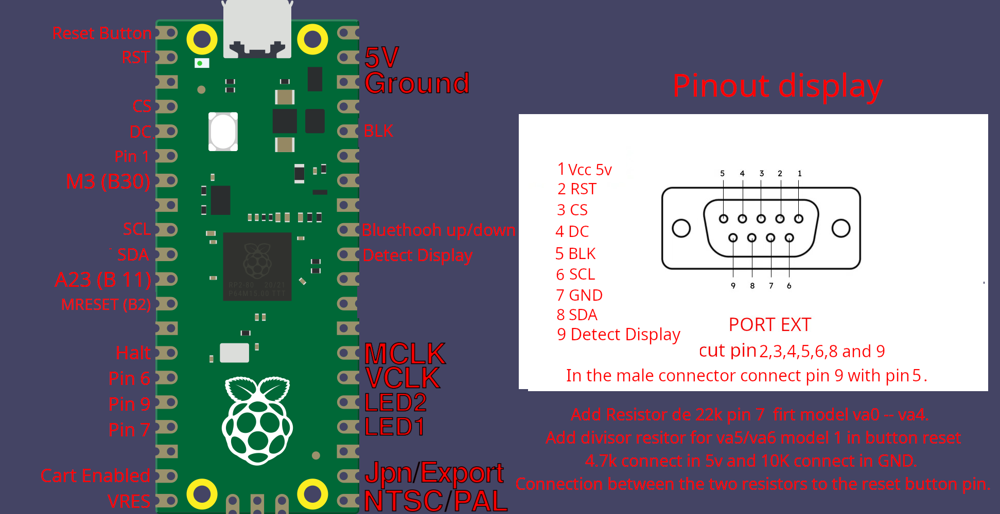

# SPECIAL OFFER:
**Mega Drive Extreme Edition IV Rev 05 Firmware for $49.90**

Contact itnp@msn.com

# Open Heart by 32mbit
# Version 3.0

Multi-region mod for Sega Genesis/Mega Drive using Raspberry Pi Pico (RP2040). This project allows switching between regions, controlling frequency, enabling Master System mode, overclocking, and much more — all via controller or physical button.

Note: Mega Drive Extreme Edition IV is the codename for the Mega Drive based on the Open Heart 2 project developed for the Brazilian community, but the functions and operation are the same.

---

## 📦 Version Information

**Open Heart Version**: available to all users for personal, non‑commercial use. [Link download](https://github.com/DUSTINODELLOFFICIAL/openheart/blob/main/build/openheart30.uf2)

**Open Heart Lite Version**: available to all users for personal, non‑commercial use. [Link download](https://github.com/DUSTINODELLOFFICIAL/openheart/blob/main/build/openheart30LITE.uf2)

**Extreme Edition**: commercial and unrestricted version.

IMPORTANT: First, download the firmware image from the link [flash_nuke](https://github.com/DUSTINODELLOFFICIAL/openheart/blob/main/build/flash_nuke.uf2) to remove any unnecessary files stored from previous Pico versions.

>[!NOTE]
> READ CAREFULLY
>
> Open Heart 3.0 is unrestricted for personal use; the time limit can now be easily disabled by you.
>
> To disable the limitation, you must have a connected display. This is necessary to inform the user that this is a version for personal, non-commercial use and that its sale is prohibited. The commercial version is the Mega Drive Extreme Edition.
>
>If used without a display, it will work, but the time limitation will remain.
>
>If you want to use it without a display and without a time limit, use the Open Heart 3.0 Lite version or purchase the Extreme Edition.

---

## 📋 Feature Comparison

| User Feature / Action | **Extreme Edition IV Rev 05** | **Open Heart 3.0** | **OpenHeart Lite 3.0** |
|---|---|---|---|
| **Restart game by control** | Available | Available | Available |
| **Pico reset by control** | Available |**Not available**  |**Not available** |
| **Europe 50 Hz ↔ 60 Hz by control** | Available | Available | Available |
| **Region Switch by control** | Available | Available | **Not available** |
| **Region Switch using Reset** | Available | Available | Available |
| **Overclock by control** | Available | Available | **Not available** |
| **Enter Standby by control** | Available | Available | **Not available** |
| **Exit Standby (Reset)** | Available | Available | — |
| **Bluetooth module suport** | Available | Available | **Not available** |
| **Beep ON/OFF by control** | Available | Available | **Not available** |
| **LED Brightness by control** | Available | Available | **Not available** |
| **Manual Logo / Screensaver Switch by control** | Available | Available | **Not available** |
| **Inactivity Screensaver** | Active | Active | Active |
| **Master System Pause by control** | Available | Available | Available |
| **Master System Reset by control** | Available | Available | Available |
| **Startup Screen** | “Extreme Edition” | “Open Heart 3.0” | “Open Heart 3.0” |
| **Custom startup message** | Available | Available | **Not available** |
| **Personal‑use notice** | — | Active | Active |
| **Unlock limit** | — | Necessary | — |
| **Display MENU**   | Available | Available | **Not available**  |
| **Hotkeys OFF/ON** | Available | Available | **Not available**  |
| **TMSS OFF/ON** | Available | **Not available** | **Not available**  |
| **Easter egg** | Available | **Not available** | **Not available**  |
| **Sound startup selection** | Available | **Not available** | **Not available**  |
| **Bug Fixed/visual wait rev05** | Available | **Not available** | **Not available**  |

---

## 🧩 Overview

Open Heart turns your console into a multi-region hub with advanced features:

- Region switching: Japan, Americas, Europe
- Frequency: 50Hz/60Hz
- Master System mode
- Dynamic overclock
- Reset and pause via controller
- Graphical display on ST7735 or SSD1306
- Bluetooth module control
- Automatic TMSS skip

---

## 🔌 Required Hardware

- Raspberry Pi Pico or compatible RP2040
- ST7735 (TFT) or SSD1306 (OLED) display
- Sega Genesis/Mega Drive (Model 1 or 2)
- Voltage divider resistors (4.7k and 10k) for Model 1 VA5/VA6
- Resistor for controller pin 7 (22k) for Model 1 VA0 to VA4
- Resitor pin VCLK 82Ω 
- 20mm Piezo Disc Transducer and 100Ω resistor.
- Wires for GPIO connections to console and controller
- Diode 1n4001 optional.

---

## 🎮 Commands

Function: Commands
- Region switch:
  B + C + Start (1s)
- Region switch (physical button):
  Reset Button (3s)
- Game reset:
  A + B + C + Start (1s)
- 50Hz/60Hz switch (Europe):
  A + B + Start (1s)
- Overclock:
  A + Start (1s)
- Pico reset:
  A + C + Start (3s)
- Enable Bluetooth:
  B + Start (2s)
- Enable/Disable Bluetooth in start:
  Hold UP while turning on the console.
- Master System pause:
  UP + B + C (1s)
- Master System reset:
  UP + C (5s)
- Toggle logo:
  C + Start (1s)
- LED brightness:
  UP + Start (1s)
- Standby mode:
   UP + Start + A (2s) Reset in console return.
- Sound Buzzer (OFF/ON):
  UP + Start + B (2s)
- Access the MENU on the display:
UP + Start + C (1s)
- Navigation in the display MENU
A and B. C to change. Start to exit

---

## 🖥️ Graphical Display

- ST7735 (TFT): colorful graphics and custom logos
- SSD1306 (OLED): monochrome graphic text
Displayed messages:

- Region and frequency
- Active mode
- Overclock status
- Bluetooth on/off
- Logos: SEGA, 16bit, Custom message

 

 

 

 

---

## ⚙️ Region Configuration

The region is saved to flash memory 10 seconds after the swap and restored at startup. LED indicators:

- Red: Japan
- Green: Americas
- Amber: Europe 50Hz
- Purple:  Europe 60Hz

---

## 🚀 TMSS Skip

Advanced technique that automatically bypasses TMSS:

- Monitors !CART_CE
- Resets the 68000 at the exact moment
- Allows direct cartridge boot

---

## Instructions
This mod is very similar to other existing mods, so adapting it to your specific console shouldn't be difficult. Schematics or references from similar mods may be helpful. Remove the oscillator and mount the Pico as close as possible to the original board location.

- **5V** and **ground** can be easily connected to the holes left by removing the oscillator. It is recommended to use a diode (I used a 1n4001) on the 5V point if you plan to update the firmware with the mod installed.

- **MCLK** should be connected to the oscillator clock output.
  
-  **VCLK** is connected to the clock input pin of the 68000 (the VDP is also connected to this pin and must be disconnected from it). VCLK and ***GND 68K***, the connection should be made by twisting two wires between 25 and 30 AWG thick. One wire will be connected to the VCLK pin and the other to a GND pin on the 68000 processor. Use a GND pin on the 68000 as close as possible to the VCLK to maintain the twist until the end. Add an 82-ohm resistor in series with the VCLK pin of the processor. The resistor should be positioned as close as possible to the Raspberry Pi pin, preferably soldered to it. Do not use a wire for the connection between the VCLK and the GND of the 68000 that exceeds 10 cm.

- **Jpn/Export** and **NTSC/PAL** should be connected to the points on your board where +5V and ground determine the region and 50/60Hz respectively.

- **VRES** and **HALT** are connected to the corresponding pins on the 68000. HALT is optional if you do not wish to use the overclocking feature.

- **Pins 1, 6, 7 and 9** (add a 22k resistor to pin 7 of the controller for Model 1 VA0 to VA4) correspond to the pins of the first controller port, counting from 1 to 9 starting with the top left pin when facing the console.

- **Cart Enable** corresponds to pin B17 of the cartridge port. Pin B1 is the leftmost pin at the front, facing the console. This is used for TMSS bypass. If you are installing this on a non-TMSS console, this pin should probably be connected to ground.

- **MRES** corresponds to pin B2 on the cartridge port. It is used for TMSS bypass and reset in Master System mode, when a flashcart enters and exits special modes such as Master System or Sega CD.

- **M3 (B30)** corresponds to pin B30 of the cartridge port.

- **A23 (B11)** corresponds to pin B11 of the cartridge port.

- **Reset Button** correspond to pin 2 the button reset.
Add a voltage divider resistor for Model 1 VA5/VA6 on the reset button. Connect a 4.7k resistor to 5V and a 10k resistor to GND. The connection point between the two resistors should be connected to the Pi Pico's Reset Button pin.

- **RST, CS, DC, SCL, SDA, BLK and Detect Display** are only needed if you plan to use an LCD display.

- **Bluetooth up/down** will only be connected if used to control a retro Bluetooth module for wireless controllers.
  
- **Buzzer** needed only for connecting the Piezo Disc Transducer that will emit beep sounds during startup and functions. Connect the GND pin to ground and the + pin to a 100Ω resistor in series with the pico output pin.

If you want a LED to show the mod's status, use a common cathode bi-color LED. Connect the cathode to ground and the two anodes to pins LED1 and LED2. The region is indicated by color:

LED1 color indicates Japan
LED2 color indicates USA/Americas
A mix of both colors indicate Europe 50Hz
LED1 High + LED2 low indicate Europe 60Hz

Overclocking is indicated by the LED blinking at 3Hz when enabled.

Bluetooth is indicated by a flashing LED at 0.5Hz when activated.

**Setting up the Pico**

IMPORTANT: First, download the firmware image from the link [flash_nuke](https://github.com/DUSTINODELLOFFICIAL/openheart/blob/main/build/flash_nuke.uf2) to remove any unnecessary files stored from previous Pico versions.

Flash the firmware onto the Pico by connecting it to the computer while holding down the BOOTSEL button. It will appear as a storage device simply drag the UF2 file onto it. The storage device will disconnect automatically.

Now, download the firmware image from this link [openheart.uf2](https://github.com/DUSTINODELLOFFICIAL/openheart/blob/main/build/openheart30DEMO.uf2) and flash it onto the Pico by repeating the procedure already described.

**Installation examples here** [Here](https://github.com/DUSTINODELLOFFICIAL/openheart/tree/main/example).

**Pico pinout here** 

**Notes & considerations**
Use at your own risk: The mod seems to work well on various Model 1 and Model 2 revisions, but not all revisions have been tested.

The first time the firmware is loaded, it automatically starts Bluetooth, so the LED will blink at 0.5Hz. Turn the console off and on again while pressing the UP button to deactivate and save the configuration.

Overclocking configures the CPU to have the master clock divided by 6 or 5 (the default is MCLK/7). This results in approximately 8MHz or 10.74MHz in the NTSC standard. Most games run well with this configuration, but be aware that crashes, graphical glitches, or controller malfunctions may still occur.

The clocks generated by the Pi Pico are imperceptibly different (+0.013% NTSC, -0.006% PAL) compared to the original oscillator specs. This is not noticeable, but may be relevant for speedrunners.

Switching between 50Hz and 60Hz, or toggling overclock on and off frequently during gameplay, may occasionally cause strange behavior. If this happens, just power cycle the console.

Some (few?) NTSC Model 1 VA7 and Model 2 VA0 consoles have a broken 50Hz mode). These consoles still work fine at 60Hz.

PAL mode composite video on NTSC consoles (and vice versa) may or may not work. RGB output will work. This may depend on your TV or the standard being used.

---

## Demonstration of how the functions work.

**This video** [here](https://youtu.be/fwqdS2af00g?si=j-Wv8TLf7hVxnpF5)

---

## 📄 License

Source-Available Freeware License

1. License Grant
The Licensor grants the Licensee a non-exclusive, non-transferable right to access and view the Software’s source code, as well as use it internally, exclusively for personal or corporate purposes, under the terms of this agreement.

2. Rights and Restrictions
Unless expressly authorized in writing by the Licensor, the Licensee may not:

(a) commercially use the Software or any derivative work (including selling, renting, offering as a service/SaaS, or consulting involving distribution of the Software);

(b) redistribute, publish, make available, or sublicense the Software or its source code, in whole or in part;

(c) modify or create derivative works for external distribution;

(d) remove or alter copyright notices, trademarks, or credits;

(e) circumvent technical protection mechanisms.

3. Internal Modification Permission
The Licensee may modify the source code only for internal use, without distribution to third parties. Any external distribution requires prior written authorization from the Licensor.

4. Intellectual Property
The Software and its source code remain the property of the Licensor. No ownership rights are transferred to the Licensee.

5. Warranty and Liability
The Software is provided “as is,” without warranties of any kind. The Licensor shall not be liable for any damages arising from the use or inability to use the Software.

6. Termination and Compliance
The Licensor may revoke this license in case of violation. The Licensee agrees to provide reasonable information to verify compliance upon request.

7. Governing Law and Jurisdiction
This agreement is governed by Brazilian law, and the courts of the Licensor’s city shall have jurisdiction over any disputes.

Note: We removed GPLv3 files that were kept in error; they were not in use. Older versions (v1.01 or earlier) remain under GPLv3.
Between January 3rd and 17th, 2026, this repository included third-party files under GPL-3.0 (driver ST7735). These were not used in the project build. On January 17th, 2026, these files were removed. The files were (and are) GPL-3.0; any restrictions of the ‘Freeware’ license do not apply to them.

For complete details, please refer to the file:
➡️ [THIRD_PARTY_NOTICES.md](https://github.com/DUSTINODELLOFFICIAL/openheart/blob/main/THIRD_PARTY_NOTICES.md)

---

## 📄 Appendix

If you don't have one of the two displays (SSD 1306 or ST7735) installed and need to obtain the serial number of your Raspberry Pi 2040, follow the steps below:

1 - With the BOOTSEL key pressed, connect PicoTool, download and load the firmware from the link below onto the pico:
[here](https://github.com/DUSTINODELLOFFICIAL/openheart/blob/main/build/serialnumber.uf2)

2 - Download and install the driver below:
https://zadig.akeo.ie/

3 - Now, access Device Manager, search for "PICO", right-click and select "Properties".

4 - Click on the "Details" tab and, in "Properties", look for "device instance path"; in the value, you will find the serial number after the backslash (\). Example below:

---

## 🧑‍💻 Author

Developed by Irineu Teza Nunes (YouTube @itnproducoes) for the Brazilian retro gaming community.
Project inspired by 32mbit and enhanced.

---

# OFERTA ESPECIAL:
**Mega Drive Extreme Edition IV Rev 05 Firmware por $49.90**

Contact itnp@msn.com

# Open Heart by 32mbit
# Versão 3.0

Mod multi-região para Sega Genesis/Mega Drive usando Raspberry Pi Pico (RP2040). Este projeto permite alternar entre regiões, controlar frequência, ativar modo Master System, overclock, e muito mais — tudo via controle ou botão físico.

Nota: Mega drive extreme edition IV é o codinome do Mega drive baseado no projeto Open heart 2 desenvolvido para a comunidade brasileira, mas o código fonte, funções e funcionamento são os mesmos.

---

**Versão Open heart**: disponível para todos apenas para uso pessoal (não comercial). [Link download](https://github.com/DUSTINODELLOFFICIAL/openheart/blob/main/build/openheart30.uf2)

**Versão Open Heart Lite**: disponível para todos apenas para uso pessoal (não comercial).[Link download](https://github.com/DUSTINODELLOFFICIAL/openheart/blob/main/build/openheart30LITE.uf2)

**Extreme Edition**: versão comercial e irrestrita.

IMPORTANTE: Primeiro, baixe a imagem do firmware do link [flash_nuke](https://github.com/DUSTINODELLOFFICIAL/openheart/blob/main/build/flash_nuke.uf2) para remover quaisquer arquivos desnecessários armazenados de versões anteriores.

>[!NOTE]
>LEIA COM ATENÇÃO
>
>Open Heart 3.0 é irrestrito para uso pessoal; o limite de tempo agora pode ser facilmente desativado por você.
>
>Para desativar a limitação, você precisa ter um monitor conectado. Isso é necessário para informar o usuário de que esta é uma versão para uso pessoal e não comercial, e que sua venda é proibida. A versão comercial é a Mega Drive Extreme Edition.
>
>Se usado sem um monitor, funcionará, mas o limite de tempo permanecerá.
>
>Se você quiser usá-lo sem um monitor e sem limite de tempo, use a versão Open Heart 3.0 Lite ou adquiria a versão Extreme Edition.

## 📋 Comparativo de Funcionalidades.

| Recurso / Ação do Usuário | **Extreme Edition IV rev 05** | **Open Heart 3.0** | **OpenHeart Lite 3.0** |
|---|---|---|---|
| **Reiniciar o jogo pelo controle** | Disponível | Disponível | Disponível |
| **Pico reset pelo controle** | Disponível |**Não disponível**  |**Não disponível** |
| **Europa 50 Hz ↔ 60 Hz pelo controle** | Disponível | Disponível | Disponível |
| **Trocar Região pelo controle** | Disponível | Disponível | **Não disponível** |
| **Trocar Região pelo Reset** | Disponível | Disponível | Disponível |
| **Overclock pelo controle** | Disponível | Disponível | **Não disponível** |
| **Entrar em Standby pelo controle** | Disponível | Disponível | **Não disponível** |
| **Acordar do Standby (Reset)** | Disponível | Disponível | — |
| **Suporte para modulo blueretro** | Disponível | Disponível | **Não disponível** |
| **Beep ON/OFF pelo controle** | Disponível | Disponível | **Não disponível** |
| **Brilho LED pelo controle** | Disponível | Disponível | **Não disponível** |
| **Troca de Logos / Protetor manual pelo controle** | Disponível | Disponível | **Não disponível** |
| **Protetor de Tela por inatividade** | Ativo | Ativo | Ativo |
| **Pause Master System pelo controle** | Disponível | Disponível | Disponível |
| **Reset Master System pelo controle** | Disponível | Disponível | Disponível |
| **Tela inicial** | “Extreme Edition ” | “Open Heart 3.0” | “Open Heart 3.0” |
| **Mensagem inicial personalizada** |  Disponível | Disponível  | **Não disponível**  |
| **Mensagem de uso pessoal**    | — | Ativa | Ativa |
| **Destravar limite** | — | Necessário | — |
| **MENU no display** | Disponível | Disponível | **Não disponível**  |
| **Atalhos OFF/ON** | Disponível | Disponível | **Não disponível**  |
| **TMSS OFF/ON** | Disponível | **Não disponível** | **Não disponível**  |
| **Easter egg** | Disponível | **Não disponível** | **Não disponível**  |
| **Seleção de inicialização sonora** | Disponível | **Não disponível** | **Não disponível**  |
| **Bug Fixed/visual aguarde rev05** | Disponível | **Não disponível** | **Não disponível**  |

---

## 🧩 Visão Geral

Open Heart transforma seu console em uma central multi-região com recursos avançados:

- Troca de região: Japão, Américas, Europa
- Frequência: 50Hz/60Hz
- Modo Master System
- Overclock dinâmico
- Reset e pausa via controle
- Exibição gráfica em ST7735 ou SSD1306
- Controle de módulo Bluetooth
- Skip automático do TMSS

---

## 🔌 Hardware Requerido

- Raspberry Pi Pico ou RP2040 compatível
- Tela ST7735 (TFT) ou SSD1306 (OLED)
- Sega Genesis/Mega Drive (Modelos 1 ou 2)
- Resistores para divisor de tensão (4.7k e 10k) model 1 va5/va6
- Resistor para o pino 7 do controlador (22kΩ).
- Resitor no pino VCLK de 82Ω.
- Transdutor Piezo Disco 20mm e resitor de 100Ω.
- Fios para GPIOs conectados ao console e controle.
- Diodo 1n4001 opcional.

---

## 🎮 Comandos

| Função                                 | Comandos                               |
|----------------------------------------|----------------------------------------|
| Troca de região                        | B + C + Start (1s)                     |
| Troca de região (botão físico)         | Botão Reset (3s)                       |
| Reset do jogo                          | A + B + C + Start (1s)                 |
| Troca 50Hz/60Hz (Europa)               | A + B + Start (1s)                     |
| Overclock                              | A + Start (1s)                         |
| Reset do Pico                          | A + C + Start (3s)                     |
| Ativar Bluetooth                       | B + Start (2s)                         |
| Ativar/desativar Bluetooth no iniciar  | Segurar UP ao ligar o console          |
| Pausa Master System                    | UP + B + C (1s)                        |
| Reset Master System                    | UP + C (5s)                            |
| Alternar logo                          | C + Start (1s)                         |
| Alternar brilho do LED                 | UP + Start (1s)                        |
| Modo standby 	                         | UP + Start +A (2s)                     |
|	                                       | Reset no console para retornar         |
| Beep OFF / ON                          | UP + Start + B (2s)                    |
| Acesso ao MENU via display             | UP + Start + C (1s)                    |
| Navegacão no MENU do display           | A e B. C para alterar. Start para sair |

---

## 🖥️ Exibição Gráfica

- **ST7735 (TFT)**: gráficos coloridos e logos personalizados
- **SSD1306 (OLED)**: texto gráfico monocromático

Mensagens exibidas:

- Região e frequência
- Modo ativo
- Status do overclock
- Bluetooth ligado/desligado
- Logos: SEGA, 16bit, Mensagem personalizada

 

 

 

 

---

## ⚙️ Configuração de Região

A região é salva na memória flash 10 segundos após a troca e restaurada na inicialização. Indicadores LED:

- Vermelho: Japão
- Verde: Américas
- Âmbar: Europa 50Hz
- Roxo: Europa 60Hz

---

## 🚀 TMSS Skip

Técnica avançada que ignora o TMSS automaticamente:

- Monitora `!CART_CE`
- Reinicia o 68000 no momento exato
- Permite boot direto do cartucho

---

## Instruções

Este mod é muito semelhante a outros mods existentes, então adaptá-lo ao seu console específico não deve ser difícil. Esquemáticos ou referências de outros mods similares podem ser úteis. Remova o oscilador e monte o Pico o mais próximo possível da localização original da placa.

- **5V** e **terra** podem ser facilmente conectados aos furos deixados pela remoção do oscilador. Recomenda-se usar um diodo (eu usei um 1n4001) no ponto de 5V se você pretende atualizar o firmware com o mod instalado.
  
- **MCLK** deve ser conectado à saída de clock do oscilador.
  
- **VCLK** O pino VCLK está conectado ao pino de entrada de clock do 68000 (o VDP também está conectado a este pino e deve ser desconectado dele). A conexão entre ***VCLK*** e ***GND 68K*** deve ser feita torcendo dois fios de bitola entre 25 e 30 AWG. Um fio será conectado ao pino VCLK e o outro a um pino GND do processador 68000. Utilize um pino GND do 68000 o mais próximo possível do VCLK para manter a torção até o final. Adicione um resistor de 82 ohms em série com o pino VCLK do processador. O resistor deve ser posicionado o mais próximo possível do pino do Raspberry Pi, preferencialmente soldado a ele. Não utilize um fio com comprimento superior a 10 cm para a conexão entre o VCLK e o GND do 68000.
  
- **Jpn/Export** e **NTSC/PAL** devem ser conectados aos pontos da sua placa onde +5V e terra determinam a região e 50/60Hz, respectivamente.
  
- **VRES** e **HALT** são conectados aos pinos correspondentes do 68000.  HALT é opcional caso você não deseje usar o recurso de overclock.
  
Os **pinos 1, 6, 7 e 9** (adicionar resistor para pino 7 do controle (22k) model 1 va0 to va4) correspondem aos pinos da primeira porta de controle, contando de 1 a 9 começando pelo pino superior esquerdo visto de frente para o console.

- **Cart Enable** corresponde ao pino B17 da porta do cartucho. O pino B1 é o mais à esquerda na frente, voltado para o console. Isso é usado para o bypass do TMSS. Se você estiver instalando isso em um console sem TMSS, provavelmente deve conectar esse pino ao terra.
  
- **MRES** corresponde ao pino B2 da porta do cartucho. Isso é usado para o bypass do TMSS and reset in mode master system, quando um flashcart entra e sai de modos especiais como Master System ou Sega CD.

- **M3 (B30)** corresponde ao pino B30 da porta do cartucho.
  
- **A23 (B11)** corresponde ao pino B11 da porta do cartucho.

- **Reset Button** corresponde ao pino 2 do botão de reset.
Adicione um resistor divisor para o modelo 1 VA5/VA6 no botão de reset. Conecte um resitor de 4,7k no 5v e 10k no GND. O ponto de conexão entre os dois resistores deve ser conectado ao pino do botão de reset do Pi Pico.

- **RST, CS, DC, SCL, SDA, BLK e Detect Display** são necessários apenas se for utilizar display LCD.
  
- **Buzzer** necessário apenas para ligação do Transdutor Piezo Disco que irá emitir os sons de beep durante inicialização e funções. Ligue o pino GND ao terra e o pino + em um resitor de 100Ω em série com o pino de saida do pico.

- **Bluetooth up/down** será conectado apenas se for utilizado para controlar um módulo bluetooth retro para controles sem fio.
  

Se quiser um LED que mostre o estado do mod, use um LED bicolor de cátodo comum. Conecte o cátodo ao terra e os dois ânodos aos pinos LED1 e LED2. A região é indicada pela cor:

Cor do LED1 indica Japão
Cor do LED2 indica EUA/Américas
Mistura das duas cores indica Europa 50Hz
Cor do LED1 High + Cor do LED2 baixa indica Europa 60Hz

O overclock é indicado por um piscar do LED a 3Hz quando ativado.

O Bluetooth é indicado por um piscar do LED a 0,5Hz quando ativado.

**Configurando o pico**

IMPORTANTE: Primeiro, baixe a imagem do firmware do link [flash_nuke](https://github.com/DUSTINODELLOFFICIAL/openheart/blob/main/build/flash_nuke.uf2) para remover quaisquer arquivos desnecessários armazenados de versões anteriores do Pico.

Grave o firmware no Pico conectando-o ao computador enquanto mantém pressionado o botão BOOTSEL. Ele aparecerá como um dispositivo de armazenamento — basta arrastar o arquivo UF2 para ele. O dispositivo de armazenamento será desconectado automaticamente.

Agora, baixe a imagem do firmware deste link [openheart.uf2](https://github.com/DUSTINODELLOFFICIAL/openheart/blob/main/build/openheart30DEMO.uf2) e grave-a no Pico repetindo o procedimento já descrito.

**Exemplos de instalação** [aqui](https://github.com/DUSTINODELLOFFICIAL/openheart/tree/main/example).

**Pinagem do pico** 

**Notas e considerações**
Use por sua conta e risco: O mod parece funcionar bem em várias revisões dos modelos 1 e 2, mas nem todas as revisões foram testadas.

A primeira vez que o firmware é carregado, ele inicia o bluetooth automaticamente, sendo assim o LED irá ficar piscando a 0,5Hz. Desligue e ligue o console com o UP pressionado para desativar e salvar a configuração. 

O overclocking configura a CPU para o clock mestre dividido por 6 ou 5 (o padrão é MCLK/7). Isso resulta em cerca de 8MHz ou 10,74 MHz no padrão NTSC A maioria dos jogos funciona bem com essa configuração, mas esteja ciente de que travamentos, falhas gráficas ou mau funcionamento do controle ainda podem ocorrer.

Os clocks gerados pelo Pi Pico são imperceptivelmente diferentes (+0,013% no NTSC, -0,006% no PAL) em relação às especificações originais do oscilador. Isso não é perceptível, mas pode ser relevante para speedrunners.

Alternar entre 50Hz e 60Hz, ou ativar/desativar o overclock com frequência durante o jogo, pode ocasionalmente causar comportamentos estranhos. Se isso acontecer, basta reiniciar o console.

Alguns (poucos?) consoles NTSC Model 1 VA7 e Model 2 VA0 têm o modo 50Hz quebrado "têm o modo 50Hz quebrado"). Esses consoles ainda funcionam normalmente em 60Hz.

O vídeo composto em modo PAL em consoles NTSC (e vice-versa) pode ou não funcionar. A saída RGB funcionará. Isso pode depender da sua TV ou do padrão utilizado.

---

## Demonstração do funcionamento das funções.

**Neste video** [aqui](https://youtu.be/fwqdS2af00g?si=j-Wv8TLf7hVxnpF5)

---

## 📄 Licença

Licença de Uso de Código-Fonte – Freeware

1. Concessão de Licença
O Licenciante concede ao Licenciado o direito não exclusivo e intransferível de acessar e visualizar o código-fonte do Software, bem como utilizá-lo internamente, exclusivamente para fins pessoais ou corporativos, conforme estes termos.

2. Direitos e Restrições
Salvo autorização prévia e por escrito do Licenciante, o Licenciado não poderá:

(a) usar comercialmente o Software ou qualquer obra derivada (inclui venda, aluguel, prestação como serviço/SaaS, consultoria com distribuição do Software);

(b) redistribuir, publicar, disponibilizar ou sublicenciar o Software ou o código-fonte, no todo ou em parte;

(c) modificar ou criar obras derivadas com finalidade de distribuição externa;

(d) remover ou alterar avisos de direitos autorais, marcas e créditos;

(e) contornar mecanismos técnicos de proteção.

3. Permissão de Modificação Interna
O Licenciado pode modificar o código apenas para uso interno, sem distribuição a terceiros. Qualquer distribuição externa exige autorização prévia do Licenciante.

4. Propriedade Intelectual
O Software e o código-fonte são de titularidade do Licenciante. Nenhum direito de propriedade é transferido ao Licenciado.

5. Garantias e Responsabilidade
O Software é fornecido “no estado em que se encontra”, sem garantias. O Licenciante não se responsabiliza por danos de qualquer natureza decorrentes do uso.

6. Termo, Revogação e Auditoria
O Licenciante pode revogar esta licença em caso de violação. O Licenciado concorda em fornecer informações razoáveis para verificar conformidade, quando solicitado.

7. Lei Aplicável e Foro
Este acordo é regido pela legislação brasileira e fica eleito o foro da cidade do Licenciante para dirimir controvérsias.

Nota: Removemos arquivos GPLv3 que foram mantidos por engano; eles não estavam em uso. Versões mais antigas (v1.01 ou anteriores) permanecem sob a licença GPLv3.
“Entre 3 e 17 de janeiro de 2026, este repositório incluiu arquivos de terceiros sob a licença GPL-3.0 (driver ST7735). Estes não foram usados ​​na compilação do projeto. Em 17 de janeiro de 2026, esses arquivos foram removidos. Os arquivos eram (e são) GPL-3.0; quaisquer restrições da licença ‘Freeware’ não se aplicam a eles.”

Para obter detalhes completos, consulte o arquivo:
➡️ [THIRD_PARTY_NOTICES.md](https://github.com/DUSTINODELLOFFICIAL/openheart/blob/main/THIRD_PARTY_NOTICES.md)

---

## 📄 Apêndice

Caso não tenha um dos dois displays (SSD 1306 ou ST7735) instalado e precise obter o número de série do Raspberry Pi 2040, siga os passos abaixo:

1 - Com a tecla BOOTSEL pressionada, conecte o PicoTool, baixe e carregue no pico o firmware do link abaixo:
[aqui](https://github.com/DUSTINODELLOFFICIAL/openheart/blob/main/build/serialnumber.uf2)

2 - Baixe e instale o driver abaixo:
https://zadig.akeo.ie/

3 - Agora, acesse o Gerenciador de Dispositivos, procure por "PICO", clique com o botão direito do mouse e selecione "Propriedades".

4 - Clique na aba "Detalhes" e, em "Propriedades", procure por "caminho da instância do dispositivo"; no valor, você encontrará o número de série após a barra invertida (\). Exemplo abaixo:

---

## 🧑‍💻 Autor

Desenvolvido por **Irineu Teza Nunes (youtube @itnproducoes)** para a comunidade retro gamer brasileira 🇧🇷  
Projeto inspirado por 32mbit e aprimorado.

